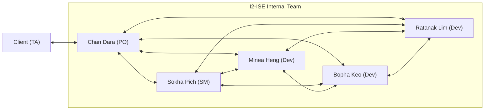

# Challenge: Communication Overhead · I2-ISE (v1.0, 2026-10-14)

**Team Size:** 5 students + 1 client (TA)  
**Weekly Capacity:** 5 members × 5 hours = 25 person-hours/week

---

## 1. Communication Paths Comparison

Using Brooks's formula: $\text{Paths} = \frac{n(n - 1)}{2}$

| Model | People ($n$) | Calculation | Total Paths | Minutes/Week (@ 20 min/path) | Hours/Week | Overhead % |
| :--- | :---: | :---: | :---: | :---: | :---: | :---: |
| **(a) Unstructured:** Everyone talks to everyone + Client | 6 | $\frac{6 \times 5}{2}$ | **15 paths** | 300 min | 5.0 hrs | **20.0%** |
| **(b) Structured:** Team of 5 + Client via PO only | 5 + PO link | $\frac{5 \times 4}{2} + 1$ | **11 paths** | 220 min | 3.67 hrs | **14.7%** |

* **Assumption:** Each active channel requires ~20 minutes per week of syncing, reviewing PRs, and answering questions.
* **Saving:** Channeling client requests exclusively through the Product Owner eliminates 4 paths, saving **1.33 hours of developer time every week**.

---

## 2. Our Team Communication Network (Model b)

## 3. Two Practices to Reduce Overhead
1. **GitHub Issues as Single Source of Truth:** All task assignments and progress live on our GitHub Project board. Team members check issues directly instead of messaging peers to ask what to do, cutting channel noise.
2. **Asynchronous Standups in Telegram:** Rather than holding long daily voice calls, members post a 3-bullet text update (Yesterday / Today / Blockers) in Telegram each morning.

---

## 4. A Sixth Member in Week 11? (Brooks's Law)

### Mathematical Computation
* **Current Model (b) Paths (5 Members + Client):**  
  $$\text{Paths}_{\text{week10}} = \frac{5(4)}{2} + 1 = 10 + 1 = \mathbf{11\text{ paths}} \quad (3.67\text{ hrs/week})$$

* **New Model (b) Paths with 6th Member:**  
  $$\text{Paths}_{\text{week11}} = \frac{6(5)}{2} + 1 = 15 + 1 = \mathbf{16\text{ paths}} \quad (5.33\text{ hrs/week})$$

* **Net Impact:** Adding 1 person increases communication channels by **+45.4%** and weekly communication overhead by **+1.66 hours**.

### Analysis
In Week 11 (Sprint 2), the project deadline is approaching. Existing developers would have to stop writing code to mentor the newcomer, explain the C++ domain architecture, and configure their local toolchains. Furthermore, the newcomer is unfamiliar with the codebase and risks introducing defects.

> ⚠️ **Brooks's Law:**  
> *"Adding manpower to a late software project makes it later."*  
> Adding a 6th member in Week 11 creates a net slowdown rather than an acceleration.

---

## 5. Reflection: The Essential Difficulty We Expect First

The essential difficulty our team expects to face first while developing ITC Club Hub is **Complexity**.

Our software must enforce multiple interdependent business rules simultaneously:
1. Preventing duplicate student registrations for the same event.
2. Strictly capping venue capacities without overbooking.
3. Locking cancellations exactly 24 hours prior to the event start time.

In a multi-user environment, ensuring that two concurrent registrations for the last remaining seat do not corrupt the attendance list introduces significant state-space complexity. Unlike accidental difficulties (such as compiler errors, CMake configuration, or IDE setup), this domain validation complexity is intrinsic to the problem requirements and cannot be removed simply by using better tools or frameworks.

### Our Mitigation Plan
* **Domain Model Encapsulation:** Encapsulate business invariants directly inside C++20 domain classes (`Event`, `Registration`) with strict preconditions.
* **Automated Unit Testing:** Use GoogleTest to test boundary conditions (e.g., registering at capacity, cancelling at 23h59m vs 24h01m) before building the CLI interface.
---

## Agreed and Signed By:
- Member 1 Name, 2026-10-14
- Member 2 Name, 2026-10-14
- Member 3 Name, 2026-10-14
- Member 4 Name, 2026-10-14
- Member 5 Name, 2026-10-14
