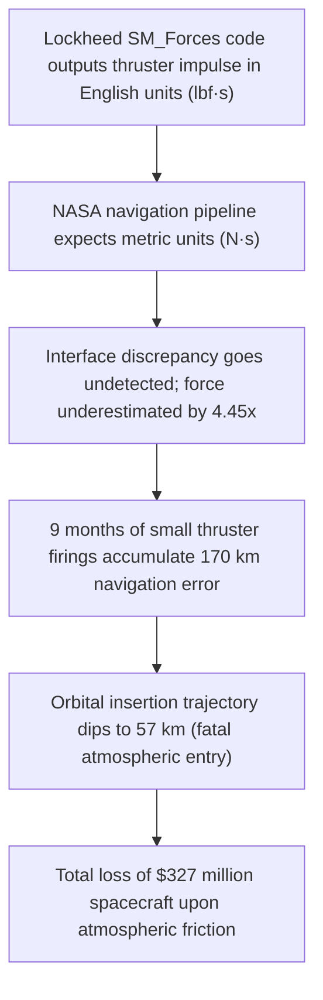

# Failure Case Analysis · Mars Climate (v1.0, 2026-10-14)

**Authors & Division of Work:**
* **Section 1 & 2 (Context & Timeline):** Chan Dara (@chandara-itc)
* **Section 3 (What Failed & Mermaid Diagram):** Sokha Pich (@sokha-pich)
* **Section 4 (Root Causes & Brooks Analysis):** Minea Heng (@minea-heng)
* **Section 5 (Prevention Practices):** Bopha Keo (@bopha-keo)
* **Section 6 & 7 (Lessons & Sources):** Ratanak Lim (@ratanak-lim)

---
## 1. Context
The **Mars Climate Orbiter (MCO)** was a 638-kilogram robotic space probe launched by NASA on December 11, 1998, as part of the Mars Surveyor '98 program. Its scientific objective was to study the Martian atmosphere, climate, and water/dust cycles. The ground-based navigation software was developed jointly: Lockheed Martin Astronautics built the spacecraft and written ground thruster modeling software, while the NASA Jet Propulsion Laboratory (JPL) navigation team operated the mission.
---

## 2. Timeline of Key Events
| Date | Event Description |
| :--- | :--- |
| **Dec 11, 1998** | Mars Climate Orbiter successfully launches from Cape Canaveral atop a Delta II rocket. |
| **March – Aug 1999** | During the 9-month transit to Mars, small thruster firings (Angular Momentum Desaturation - AMD) accumulate unmodeled trajectory deviations. |
| **Sep 15, 1999** | Trajectory calculations show the spacecraft will arrive lower than planned (150 km altitude vs. intended 226 km), but no corrective maneuver is executed. |
| **Sep 23, 1999 (09:00 UTC)** | Spacecraft initiates the Mars Orbit Insertion (MOI) main engine burn behind the planet Mars. |
| **Sep 23, 1999 (09:04 UTC)** | Radio communication is lost 10 minutes earlier than predicted as the spacecraft enters the occultation zone behind Mars. |
| **Sep 23, 1999 (10:00 UTC)** | Radio signals fail to re-establish. Investigation later confirms the probe passed at an altitude of only 57 km (atmospheric entry limit was 80 km), causing it to disintegrate in the Martian atmosphere. |
---

## 3. What Failed
The fatal failure occurred because two mission-critical software components communicated using incompatible units of measurement. A ground software file called `SM_Forces` (written by contractor Lockheed Martin) computed thruster impulse in **United States Customary units (pound-force seconds, $lbf\cdot s$)**. However, NASA's trajectory processing software (`Automated Telemetry Processing`) expected the impulse data in **metric units (Newton-seconds, $N\cdot s$)** as specified by the Software Interface Specification (SIS). Because 1 pound-force equals approximately 4.45 Newtons, the ground software underestimated the thruster force by a factor of 4.45. Over 9 months of flight, these unaccounted-for forces accumulated into a 170-kilometer trajectory error.

## Mermaid Diagram

## 4. Root Causes Analysis
#	Root Cause	Type	Essential Difficulty (Brooks)	Why / Justification

| # | Root Cause | Type | Essential Difficulty | Why / Justification |
| :-: | :--- | :---: | :---: | :--- |
| **R1** | **Interface Unit Mismatch** One team used $lbf\cdot s$ while the spec required $N\cdot s$. Primitive types (`double`) hid the semantic unit. | `Technical` | **Invisibility** | Software has no physical shape. A raw `double impulse;` does not display its unit, making the bug completely invisible during manual code reviews without strong types. |
| **R2** | **Multi-Vendor Conformity** NASA integrated software across different vendor and organizational standards. | `Process` | **Conformity** | Software must conform to external human institutions. Lockheed conformed to US Customary standards, while NASA conformed to metric standards. |
| **R3** | **Missing End-to-End Tests** Unit tests passed, but no automated integration test verified cross-team output. | `Process` | **Complexity** | The massive number of interacting states between ground telemetry files and orbital flight systems made informal, manual testing impossible. |
| **R4** | **Ignored Anomaly Reports** Trajectory discrepancies were observed weeks prior, but formal review was bypassed. | `Organisational` | **Changeability** | Late changes were resisted close to arrival because updating flight software was seen as high risk without an automated test safety net. |

## 5. Practices That Would Have Prevented or Limited the Failure

| Root Cause | Engineering Practice | Relevant Course Chapter |
| :--- | :--- | :---: |
| **R1** *(Unit Mismatch)* | **Strong Typing & Interface Contracts** In C++20, wrap quantities into distinct type-safe classes (or `std::chrono`-style dimension types) rather than raw `double` types. | `Chapter 02` Architecture & Domain Types |
| **R2** *(Conformity)* | **Explicit Interface Specs & Contract Testing** Enforce strict Software Interface Specifications (SIS) and run automated build-time boundary format checks. | `Chapter 08` DevOps & CI/CD Pipelines |
| **R3** *(Missing Integration Tests)* | **Automated End-to-End Pipeline Testing** Implement automated regression tests where outputs of subsystem A are directly fed into subsystem B to verify interoperability. | `Chapter 09` Testing & Quality Assurance |
| **R4** *(Ignored Anomalies)* | **Blameless Anomaly Triage Meetings** Establish structured defect escalation and impact analysis so flight engineers can investigate unexpected numbers without friction. | `Chapter 10` Maintenance & Evolution |

## 6. Concrete Lessons for ITC Club Hub
1. Type-Safe Domain IDs: In ITC Club Hub, never pass raw integers or plain strings for entities. A StudentId, a ClubId, and an EventId must be distinct strong types in C++ (e.g., struct StudentId { std::string value; };) so that passing a ClubId where an EventId is expected causes a compile error.
2. Automated Cross-Module Validation: Do not assume CSV or file storage files written by the data layer contain valid data. Write automated GoogleTest integration tests that write data to disk and reload it to verify invariants (such as capacity $\ge 0$ and non-overlapping booking timestamps).

## 7. Sources
1. NASA Mars Climate Orbiter Mishap Investigation Board, Phase I Report, November 10, 1999 (Primary Official Investigation Report). https://ntrs.nasa.gov/citations/19990021616
2. Stephenson, A. G., et al., Mars Climate Orbiter Failure Board Report, NASA Headquarters, 1999.
3. Brooks, Frederick P., "No Silver Bullet: Essence and Accidents of Software Engineering", IEEE Computer, 1987.