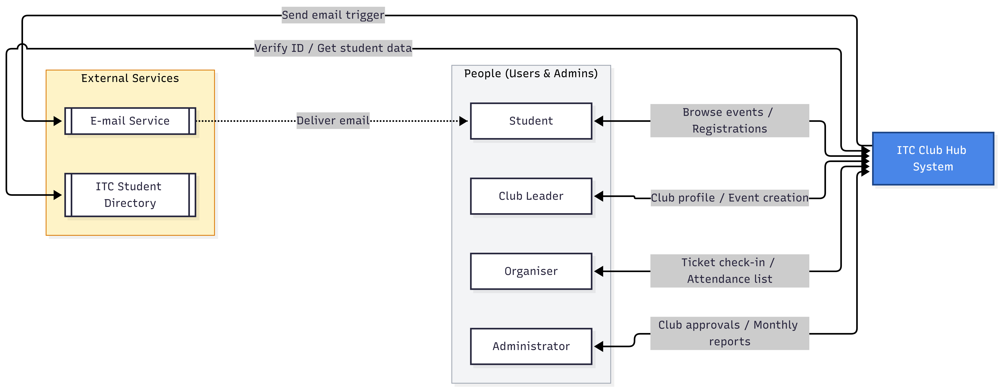
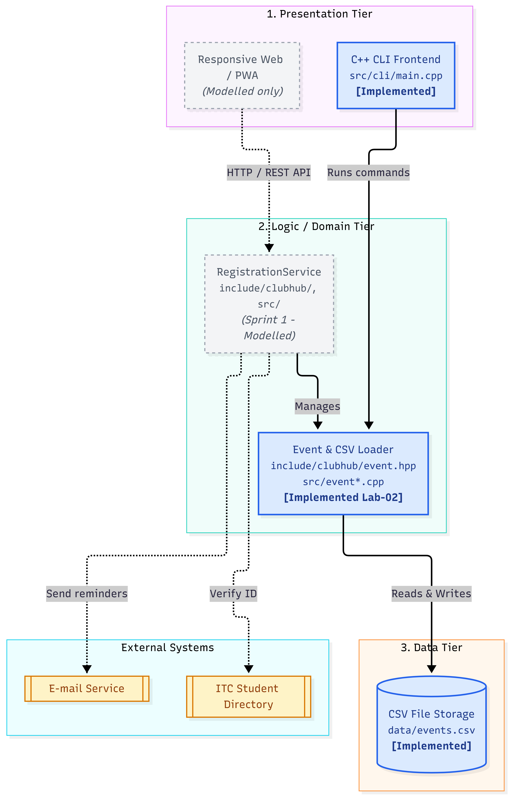

# Lab-02 · Types of Applications & Architecture (v1.0, 2026-10-19)

## Files of this Lab
| File | Task | Author(s) |
| :--- | :---: | :--- |
| `lab02/app-classification.md`, `app-quadrant.mmd` | Task 1 | Whole Team |
| `lab02/adr-001-application-type.md` | Task 2 | Product Owner & Team |
| `lab02/quality-scenarios.md` | Task 3 | Scrum Master & Team |
| `lab02/context-diagram.mmd`, `architecture.mmd` | Task 4 | Systems Architect |
| `include/clubhub/event*.hpp`, `src/event*.cpp` | Task 5 | Developers |
| `src/cli/main.cpp`, `CMakeLists.txt`, `data/events.csv` | Task 5 | Developers |

## Inputs Reused from Lab-01
* Problem statement & Stakeholder list from `lab01/team-charter.md`
* Decision rules from `lab01/decisions.md`

## Architecture Diagrams

## Change Log
| Date | Version | Change | Commit |
| :--- | :--- | :--- | :--- |
| 2026-10-19 | `v0.2.0` | Event domain class, chrono time parsing, CSV loader, and list-events CLI command | abc1234 |
