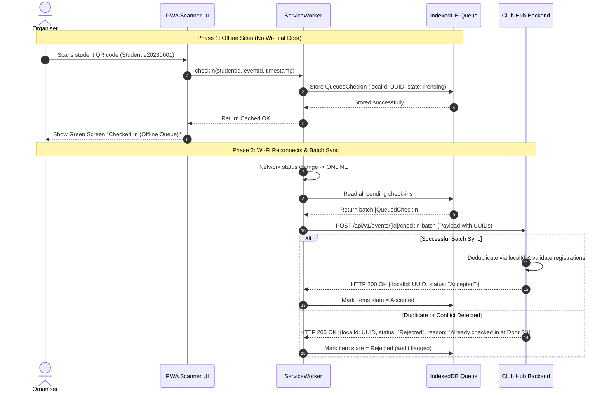

# Challenge: Offline-First Check-In for ITC Club Hub
Version 1.0 · 2026-10-20 · Team: I2-ISE

---

## 1. Sequence Diagram: Offline Scan & Reconciliation
This diagram illustrates an organiser scanning a QR code while disconnected, saving it locally, reconnecting to Wi-Fi, and batch-syncing to the server.

## 2. Conflict Resolution Rules

When phones scan tickets without internet, errors can happen when they reconnect. The server fixes them using these 5 simple rules:

| # | What Happened (Case) | Who Wins? | What the Organiser Sees | What the Server Saves |
| :-: | :--- | :--- | :--- | :--- |
| **1** | **Same student scanned at Door 1 and Door 2** | **The earlier scan wins.** | Both doors show green at first. After sync, Door 2 sees: *"Already checked in at Door 1"*. | Saves Door 1 check-in. Marks Door 2 scan as a duplicate. |
| **2** | **Student cancelled online before arriving** | **The cancellation wins.** | Shows green at first. After sync, shows yellow warning: *"Student cancelled ticket earlier"*. | Keeps ticket as `Cancelled`. Rejects the door check-in. |
| **3** | **Student never registered at all** | **Nobody (Rejected).** | Red screen right away: ❌ *"Student not found on list"*. | Saves nothing. Logs an unknown scan attempt. |
| **4** | **Phone re-sends the same scan twice** | **First upload wins.** | Green screen normally (no error). | Keeps only 1 record. Safely ignores the second copy. |
| **5** | **Phone clock is 7 minutes wrong** | **Server adjusts the time.** | Green screen normally (organiser doesn't notice). | Saves both the phone time and the real server time to fix the 7-minute difference. |

## 3. Why the Idempotency Key (`localId`) is Essential

### What is Idempotency?
An operation is **idempotent** if doing it once has the exact same result as doing it multiple times:
$$f(f(x)) = f(x)$$
In our system, receiving the same check-in upload 1 time or 10 times must result in **exactly 1 attendance record**.

---

## 3. Why the Idempotency Key (`localId`) is Essential

Each check-in has a unique tracking number called localId. It is important because the phone may send the same check-in more than once when the network is unstable. The server uses localId to recognise repeated requests and return the previous result without creating duplicate attendance records. This keeps attendance data accurate and makes retries safe.

## 4. Trade-Offs Against Lab-02 Quality Scenarios

Implementing an offline-first architecture introduces architectural trade-offs across our existing quality attribute scenarios:

### 🟢 Quality Attributes Improved
* **QAS-02 (Performance at Check-In):**  
  Scans are evaluated instantly against local browser IndexedDB cache in $\le 100\text{ ms}$, completely eliminating network round-trip delays during high-traffic door entry.
* **QAS-01 (Availability):**  
  The door check-in system achieves $100\%$ operational availability at the entrance, regardless of router crashes, bandwidth congestion, or campus ISP dropouts.

### 🔴 Quality Attributes Made Harder
* **QAS-04 (Security & Strict Consistency):**  
  Introduces an *eventual consistency* window. If an attendee cancelled their ticket moments before arrival, they might still gain entry before the scanner reconnects and synchronizes with the server.
* **QAS-05 (Modifiability & System Complexity):**  
  Managing bidirectional synchronization, persistent offline queues, retry policies, and conflict resolution tables significantly increases codebase complexity compared to a standard online-only API.

---

## 5. New Quality Scenario: 5-Minute Network Outage (QAS-07)

This scenario formally evaluates how the architecture handles a total network breakdown during peak arrival:

| Part | Description |
| :--- | :--- |
| **Source** | Event organiser scanning attendee tickets at the hall entrance. |
| **Stimulus** | Venue Wi-Fi router overheats and crashes for 5 minutes during peak arrival (100 students arriving). |
| **Environment** | Total network disconnection at the event entrance hall. |
| **Artifact** | PWA Scanner interface, local ServiceWorker queue, and IndexedDB client storage. |
| **Response** | The scanner transitions transparently to offline mode, continues scanning QR codes without blocking, stores all 100 records with unique client UUIDs in the local queue, and automatically batch-synchronizes all records to the central server within 10 seconds of network restoration. |
| **Response Measure** | Exactly **0 scan interruptions**; **100% of the 100 arriving attendees** admitted without delay; exactly **0 check-in records lost or duplicated** upon server reconciliation. |
