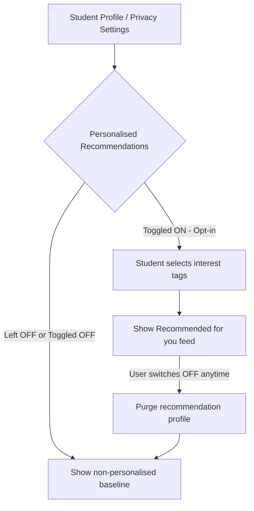

# AI Feature Proposal: "Recommended for You" Event Recommender Version 1.0 · 2026-10-26 · Authors: Team I2-ISE

---

## 1. Problem and Non-Personalised Baseline

### The User Problem
Students currently have to browse through dozens of weekly club events across multiple departments. Many relevant workshops and seminars are missed simply because students do not know they exist.

### Non-Personalised Baseline (Before adding AI)
Before implementing complex AI, the system should offer simple, privacy-safe, non-personalised heuristics:
- **"Popular on Campus":** Top 5 events with the highest current registrations.
- **"Happening Soon":** Events taking place within the next 48 hours.
- **"Browse by Category":** Filter by tags (e.g., Tech, Sports, Arts, Culture).

*Only if this baseline proves insufficient should personalised machine learning be considered.*

---

## 2. Data Needed

To train and run a personalized recommender, the following data would be processed:

| Field | Source | In Task 1 Inventory? | New Purpose / Consent? | Minimisation Rule |
|---|---|:---:|---|---|
| `event_category_history` | Past check-ins | Yes (attendance) | **Yes:** Profiling student interests requires separate explicit consent. | Only store high-level categories (e.g. "Robotics: 3", "Music: 1"); do not track time of day or who they attended with. |
| `department_faculty` | ITC Directory | No (dropped) | **Yes:** Needed to recommend faculty-specific seminars. | Coarse department level only (e.g., "GIC", "GCA"); no grades, GPA, or year of study. |
| `event_tags` | Event details | Yes | No (public event metadata). | Open event tags; no personal data involved. |
| `student_name` / `email` | Profile | Yes | **No (Not needed):** The ML model only needs an anonymous token ID. | **Dropped from ML pipeline:** Strip all names, emails, and phone numbers before feeding to recommender. |

---

## 3. Bias Risks and Fairness Checks

| Bias Risk | Who Is Harmed | Mitigation Strategy | Fairness Check (Metric & Threshold) |
|---|---|---|---|
| **Popularity Bias / Filter Bubble** | Small clubs (e.g., Chess, Debate) get zero visibility; mega-clubs dominate. | Introduce 20% random exploration ("serendipity injection") from small clubs with <30 members. | **Catalog Coverage:** At least 85% of active clubs must appear in recommendations weekly across the student body. |
| **Department Stereotyping** | Female students or non-tech majors never get recommended engineering/coding hackathons. | Do not use gender or demographic features; base recommendations strictly on voluntary tag selections. | **Demographic Parity:** Recommendation rates for technical events must not deviate by more than 10% across genders or faculties. |
| **Cold-Start Penalty** | Year 1 students with zero history get blank or irrelevant suggestions. | Fall back immediately to the non-personalised baseline ("Popular on Campus") until 3 events are attended. | **Cold-Start Click-Through Rate (CTR):** New student engagement must be within 15% of active user engagement. |
| **Academic Tracking Risk** | Disciplinary or low-attendance students get targeted with remedial events only. | Strictly air-gap Club Hub recommendations from university academic marks or disciplinary records. | **Zero-correlation Audit:** Recommendation scores must have zero mathematical correlation with student GPA. |

---

## 4. Transparency: "Why am I seeing this?"

Every recommended event card in the UI displays an info icon `(ℹ️)`. Clicking it reveals a plain-English explanation:

> **Example:**  
> **Event:** *Introduction to Autonomous Drones Workshop*  
> **Why you are seeing this:**  
> *"You attended the 'Robotics Club Showcase' last month, and you selected 'Technology & Engineering' in your interest preferences. We do not use your grades, age, or friends' activity to pick this event."*

---

## 5. Opt-Out / Opt-In Design

Because personalized recommendations involve algorithmic profiling under GDPR principles, this feature operates on **strict opt-in**:

## 6. Final Recommendation
### GO WITH CONDITIONS
We recommend proceeding with the development of the AI Event Recommender only if the following four strict conditions are satisfied:

Before implementing complex AI, the system should offer simple, privacy-safe, non-personalised heuristics:
1. **Strict Opt-In by Default:** The recommendation engine remains inactive until a student explicitly turns it on in their settings. No pre-checked boxes or forced activation during account signup.
2. **Pseudonymised Model Inputs:** The recommender pipeline only consumes salted hashes (hash(studentId)) and high-level interest tags. Real names, email addresses, phone numbers, and academic records must never enter the model.
3. **Guaranteed Fallback Quality:** Students who opt out must never receive a degraded user experience; they will be provided with the high-quality curated baseline ("Popular on Campus").
4. **Permanent Purge Guarantee:** When a student disables the feature, their behavioral profile, interest scores, and recommendation cache must be completely wiped from active storage within 24 hours.

### Owner of Fairness Audits
The **Scrum Master** and **Product Owner** will conduct a bi-weekly fairness review before each sprint review to evaluate recommendation logs against the Catalog Coverage (≥ 85%) and Demographic Parity thresholds.