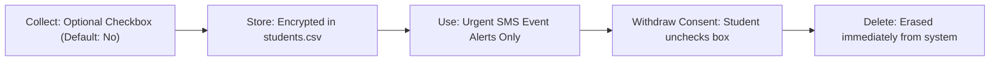

# Data Inventory · ITC Club Hub
Version 1.0 · 2026-10-23 · Team: I2-ISE

## 1. Personal Data Inventory

| Field | Subject | Purpose | Legal basis / consent | Retention | Who can see it | Stored in | Decision |
|---|---|---|---|---|---|---|---|
| `studentId` | Student | Identify student; prevent duplicate registrations | Contract (necessary for service) | Until graduation + 6 months | Admin, Organiser (masked) | `data/students.csv` | **Mask** for organisers (`e2022****`) to prevent identity exposure at the door. |
| `name` | Student | Display registration list to event organisers | Contract (necessary for service) | Until graduation + 6 months | Admin, Organiser | `data/students.csv` | **Keep**: Essential for check-in verification at the door. |
| `email` | Student | Send event confirmation and cancellation notice | Contract (necessary for service) | Until graduation + 6 months | Admin | `data/students.csv` | **Keep**: Required for vital event communications. |
| `phone` | Student | Send urgent SMS notifications / reminders | Consent (opt-in only) | While consent is active; deleted upon withdrawal | Admin | `data/students.csv` | **Keep optional**: Only collected if student explicitly opts in to SMS alerts. |
| `clubMemberships`| Student | Track which clubs the student belongs to | Legitimate interest | Until student leaves club | Admin, Club Leader | `data/memberships.csv` | **Keep**: Required for club activities and leadership. |
| `attendance` | Student | Track event attendance and calculate stats | Legitimate interest | 1 academic year | Admin, Organiser, Student | `data/registrations.csv` | **Aggregate** for reports; individual records purged after 1 year. |
| `dateOfBirth` | Student | Candidate: Age verification | None | None | None | Not stored | **Drop**: Club events are open to all enrolled ITC students; age is irrelevant. |
| `photo` | Student | Candidate: Face verification at door | None | None | None | Not stored | **Drop**: High privacy risk; student ID card check is sufficient. |
| `nationalId` | Student | Candidate: Government identity proof | None | None | None | Not stored | **Drop**: ITC student ID is already sufficient; collecting national ID is excessive. |

---

## 2. Rules for Copies of Personal Data

| Copy Type | Rule |
|---|---|
| **Log files** | Only output `redacted()` data; never write full name, plain email, or phone number to logs. |
| **CSV exports** | Only exported by admins; sensitive columns (phone, email) must be stripped for general club leaders. |
| **Test fixtures** | Strictly use fake dummy data (`e20990001`, `student@example.edu`); NEVER use real student information. |
| **Backups** | Encrypted at rest; access restricted to system administrators; purged according to retention limits. |
| **Screenshots in docs** | Mask or blur any student names, IDs, and contact info before publishing in reports or READMEs. |

---

## 3. Lifecycle of the Phone Field

