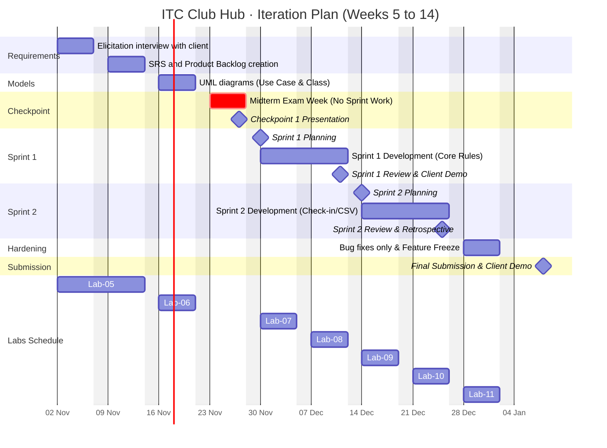

# Iteration Plan (Weeks 5 to 14) · Team I2-ISE
Version 1.0 · 2026-11-04 · Lead: Scrum Master (Sprint 1)

---

## 1. Semester Gantt Chart (Mermaid)

---

## 2. Iteration Goals and Capacity Table

### Capacity Formula:
$$\text{Capacity} = \text{Members (5)} \times \text{Hours/Week (6)} \times \text{Duration (2 weeks)} \times 0.8\text{ (Focus Factor)} = \mathbf{48\text{ productive person-hours}}$$

| Iteration | Weeks | Calendar Dates | Goal | Candidate Features | Capacity | Exit Criterion (Definition of Done) |
| :--- | :---: | :---: | :--- | :--- | :---: | :--- |
| **Requirements** | 5–6 | Nov 02 – Nov 13 | Elicit and document all functional & non-functional requirements. | User stories for Student, Club Leader, and Admin; initial backlog. | ~48h | SRS approved by TA; product backlog populated with prioritized user stories. |
| **Modeling** | 7 | Nov 16 – Nov 20 | Create structural and behavioral software architecture. | Use Case diagram, Domain Class diagram, sequence diagrams. | ~24h | UML models reviewed; complete alignment with SRS requirements. |
| **Checkpoint 1** | 8 | Nov 23 – Nov 27 | Review progress; focus on midterm exams (no coding). | Presentation slides and deliverable audit. | ~10h | Passing Checkpoint 1 evaluation with client/instructor. |
| **Sprint 1** | 9–10 | Nov 30 – Dec 11 | Build and verify core domain models and booking business rules in C++20. | `Event`, `Student`, `Registration`, capacity limits, 24h cancellation rule. | **48h** | All Sprint 1 user stories have passing GoogleTest unit tests; clean build with CMake. |
| **Sprint 2** | 11–12 | Dec 14 – Dec 25 | Implement persistence, door check-in, and accessible CLI frontend. | CSV storage reader/writer, check-in command, accessible error output. | **48h** | End-to-end CLI runs cleanly; 100% regression tests pass; client demo completed. |
| **Hardening** | 13 | Dec 28 – Jan 01 | Feature freeze; bug fixing, documentation polish, and release packaging. | Defect fixes, documentation updates, memory leak checks. | ~24h | Zero open high-priority bugs; clean build on Windows/Linux; README updated. |
| **Submission** | 14 | Jan 04 – Jan 08 | Final demonstration and project defense. | Final release tag, live demo presentation. | ~10h | Code merged to `main`; release tagged; successful client demonstration. |