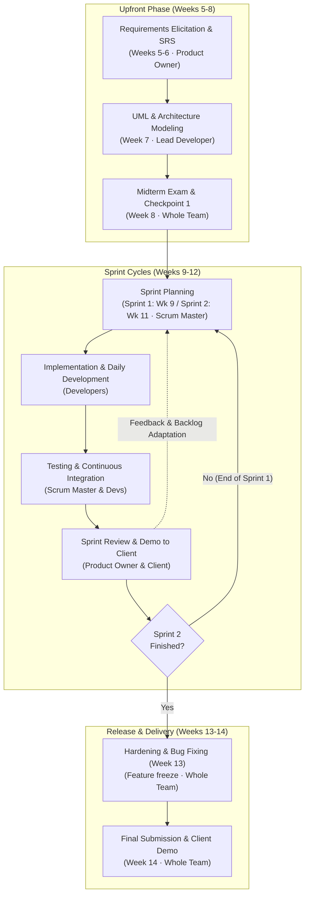

# PDR-001 · Development Process for ITC Club Hub
Status: Proposed  
Date: 2026-11-04  
Deciders: All Team Members (Team I2-ISE)  
Lead: Product Owner  

---

## 1. Context (Driving Facts)

1. **Course Calendar:** A 15-week academic semester with fixed milestones: Checkpoint 1 in Week 8, and final submission/demo in Week 14 (`lab01/team-charter.md`).
2. **Team Capacity:** 5 student developers, each contributing approximately 6 hours per week alongside other university courses (`lab01/team-charter.md`).
3. **Client Availability:** The client (represented by the instructor / TA) is available for questions and demos for approximately 30 minutes once a week during lab sessions (`Case Brief`).
4. **Evolution of Requirements:** Features (event booking, waiting lists, cancellation deadlines) will be discovered and refined progressively rather than remaining static (`lab04/process-comparison.md`).
5. **Technical Learning Curve:** The team is actively mastering modern C++20, CMake, GoogleTest, and Git branching workflows (`lab02/application-type.md`).

---

## 2. Options Considered

| Option | Weighted Score (Task 2) | Pros | Cons |
| :--- | :---: | :--- | :--- |
| **A. Waterfall** | 1.65 / 5.00 | Clear documentation; simple sequential milestones. | Catastrophic risk if bugs or requirement flaws are found in Week 13; no working software until the end. |
| **B. Incremental Delivery** | 3.80 / 5.00 | Builds features slice-by-slice; allows early testing. | Lacks defined feedback rituals (retrospectives/reviews); assumes architecture is fixed early. |
| **C. Scrum-style Iterative** | **4.60 / 5.00** | Early working increments; embraces changing client needs; regular inspection and adaptation. | Needs strong team discipline; full textbook Scrum has too many meetings for part-time students. |
| **D. No Defined Process** | n/a (0.00) | Maximum temporary freedom; zero documentation overhead. | Extreme panic, merge conflicts, missed deadlines, and guaranteed project failure. |

---

## 3. Decision

We will use a **Tailored Scrum-Style Iterative Process** with a structured upfront specification and modeling phase.

Because textbook enterprise Scrum is designed for full-time teams, we customize (tailor) 6 key process elements to fit our university schedule:

### Process Tailoring Table

| Element | Reference Practice (Textbook Scrum) | Our Tailoring for Club Hub | Reason for Tailoring |
| :--- | :--- | :--- | :--- |
| **1. Up-front Work** | Zero upfront architecture; emergent design from user stories. | **Structured Upfront Phase:** Weeks 5–6 for SRS/Backlog, Week 7 for UML models. | Required for Checkpoint 1 in Week 8 and academic course evaluation. |
| **2. Iteration Length** | 2 to 4 weeks flexible sprints. | **Strict Two-Week Sprints:** Sprint 1 (Weeks 9–10) and Sprint 2 (Weeks 11–12). | Fits the academic rhythm between Midterm (Week 8) and Hardening (Week 13). |
| **3. Team Meetings** | 15-minute daily standup in person every morning. | **One weekly in-person meeting** during lab + asynchronous updates in Telegram chat. | Students have conflicting class schedules across weekdays. |
| **4. Team Roles** | Fixed Product Owner, Scrum Master, and Developers. | **Fixed Product Owner** (client liaison); **Rotating Scrum Master** (Sprint 1 vs Sprint 2). | Gives multiple students leadership experience while maintaining a single client point of contact. |
| **5. Documentation** | Working software over comprehensive documentation. | Lightweight Markdown documents kept inside repo (`docs/`, `lab05/`, etc.). | Project requires traceable artifacts for university grading. |
| **6. Definition of Done (DoD)** | Production-ready deployed software. | Code merged to `main`, compiles with CMake, 100% tests pass in GTest, no raw PII in logs. | Tailored to C++20 CLI application testing criteria. |

---

## 4. Consequences

### Positive Consequences:
1. **Early Working Software:** By Week 10 (end of Sprint 1), we have a working, tested C++ CLI application to demonstrate to the client.
2. **Reduced Integration Risk:** Continuous merging and automated GoogleTests prevent last-minute "merge hell".
3. **Client Alignment:** Bi-weekly demos allow our TA to correct misunderstandings before final grading.

### Negative Consequences & Risks (with Mitigations):
1. **Risk: Student Procrastination ("Student Syndrome").**  
   *Mitigation:* The Scrum Master tracks weekly progress on GitHub Issues/Projects; tasks are broken down into small units (&le; 4 hours each).
2. **Risk: Over-engineering Upfront.**  
   *Mitigation:* Keep UML models and SRS strictly focused on core business rules (event capacity, 24h cancellation).
3. **Risk: Meeting Fatigue.**  
   *Mitigation:* Limit weekly meetings to 45 minutes; use chat for daily blockers.

---

## 5. Process Diagram

---

## 6. Approvals

Every team member has reviewed and approved this development process:

- **Sok Dara (Product Owner):** Approved (2026-11-04)