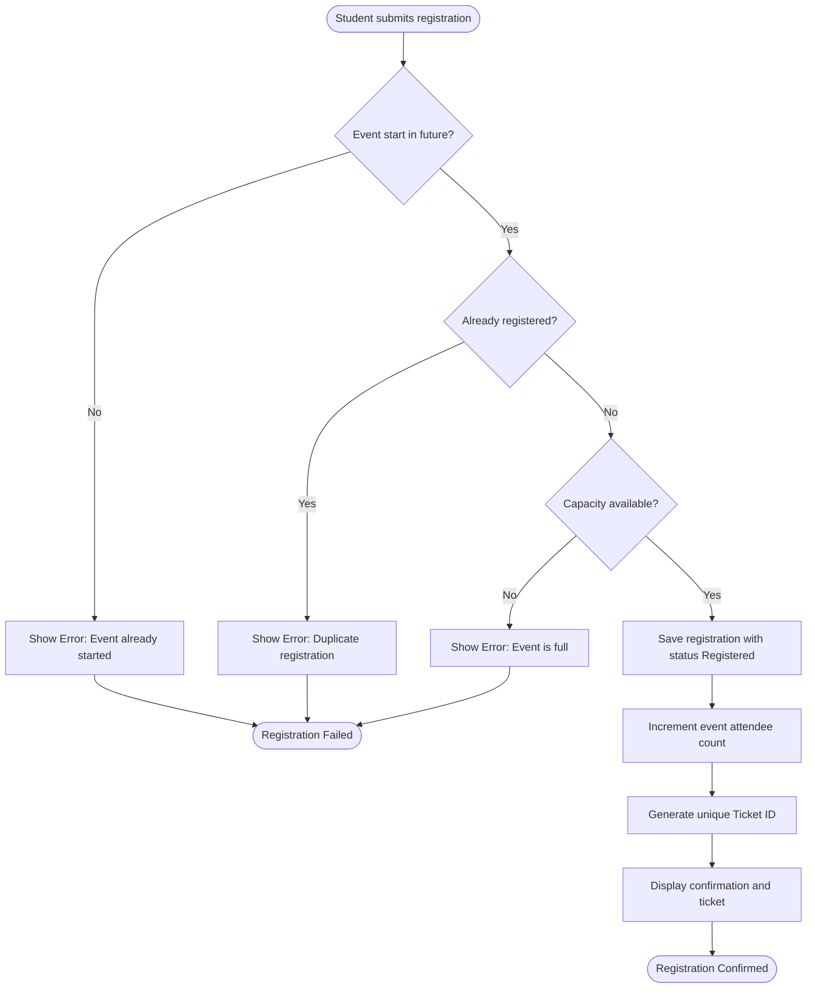

# Use Case UC-02 · Register for an Event
Version 1.0 · 2026-11-14 · Team: I2-ISE

---

### Use Case Metadata
* **Primary Actor:** Student
* **Supporting Actors:** Club Leader, System Clock / Scheduler
* **Level:** User Goal
* **Stakeholders & Interests:**
  * *Student:* Wants to secure a seat quickly with immediate proof of registration.
  * *Club Leader:* Wants fair, first-come-first-served registration without room overbooking.
  * *University Admin:* Requires accurate student identification and privacy compliance.
* **Preconditions:**
  1. The student has an active university identity (`studentId`, `name`, `email`).
  2. The event exists, belongs to an approved club, and its start time is in the future.
* **Trigger:** The student submits a registration request for a specific event ID.

---

### Main Success Scenario (Happy Path)
1. The student selects an upcoming event and submits their registration with their student ID.
2. The system verifies that the event's start time is in the future.
3. The system checks `data/registrations.csv` and verifies that the student is not already registered for this event.
4. The system verifies that the event's current registration count is less than the maximum room capacity.
5. The system records the registration with status `Registered` and timestamps the entry.
6. The system increments the event's confirmed registration count.
7. The system issues a unique confirmation ticket ID (e.g. `TICK-E001-042`).
8. The system displays a confirmation message with the event details, ticket ID, and remaining open seats.

---

### Alternative & Exception Flows

* **2a. Event Start Time is in the Past:**
  * 2a1. The system detects `event.start <= current_time`.
  * 2a2. The system rejects the registration with error: `"Cannot register for an event that has already started."`
  * 2a3. Use case ends in failure.

* **3a. Duplicate Registration Attempt:**
  * 3a1. The system detects an existing record with matching `eventId` and `studentId`.
  * 3a2. The system rejects the request with error: `"Student is already registered for this event."`
  * 3a3. The system displays the existing ticket ID.
  * 3a4. Use case ends in failure.

* **4a. Event Capacity is Full:**
  * 4a1. The system detects `current_registrations >= max_capacity`.
  * 4a2. The system rejects the registration with error: `"Event is full (capacity reached)."`
  * 4a3. The system informs the student of the full status and suggests other open events.
  * 4a4. Use case ends in failure.

* **5a. Invalid Student Credential:**
  * 5a1. The student ID is empty, or email lacks a valid format.
  * 5a2. The system throws validation error and prompts for valid institutional credentials.
  * 5a3. Use case ends in failure.

---

### Postconditions
* **Success:** A new registration record is saved in `data/registrations.csv`, the event's remaining capacity decreases by 1, and the student holds a valid ticket ID.
* **Failure:** No records are modified, event capacity remains unchanged, and an informative error message is displayed to the user.

---

### Use Case Flowchart

